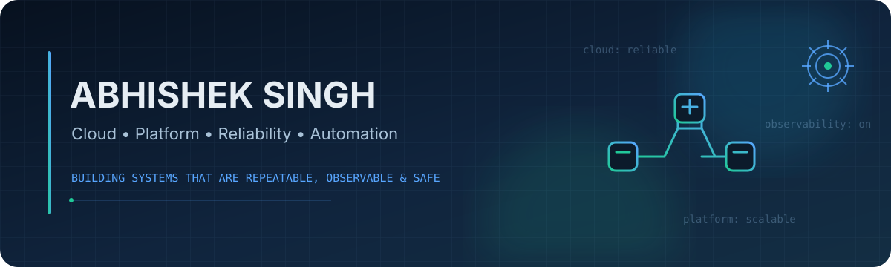

  

<h1 align="center">Hi, I'm Abhishek Singh 👋</h1>

<strong>Platform Engineer | Cloud Infrastructure | DevOps | Kubernetes | SRE | GitOps | Automation</strong>

  Building a practical engineering portfolio around cloud foundations, platform operations, and automation. 
  I value safe defaults, clear verification, repeatable steps, and honest documentation.

  
  

---

## About me

I’m developing a focused portfolio for **platform engineering, cloud infrastructure, DevOps, and SRE** roles. My public work currently centers on a structured Google Cloud learning workspace and PowerShell-based repository utilities. I document prerequisites, safe configuration, validation, cost awareness, and cleanup rather than presenting planned work as production experience.

**Current evidence:** [GCP Training](https://github.com/abhisheksingh-infracraft/gcp-training) is a structured learning workspace. It is currently private, so its contents are not publicly reviewable. The profile below distinguishes existing work from areas I plan to build out.

## Engineering focus

| Domain | Current status |
|:--|:--|
| Google Cloud | Structured learning workspace; GCP CLI setup, module outlines, and safety guidance |
| Scripting and tooling | PowerShell is the detected language in the GCP training repository; Git workflow utilities are documented there |
| Platform engineering, Kubernetes, CI/CD, IaC, and observability | Learning and portfolio roadmap—not represented here as verified professional or production experience |

### Areas I’m building toward

`GCP` · `Azure` · `Kubernetes` · `Docker` · `Terraform` · `GitHub Actions` · `GitOps` · `Prometheus` · `Grafana` · `Python` · `Bash` · `PowerShell`

These are areas of focus, not a claim of equal proficiency. I’ll link completed, reviewable implementations here as they are built and documented.

## Portfolio

### Current work

- **[GCP Training](https://github.com/abhisheksingh-infracraft/gcp-training)** — structured Google Cloud learning path with lab checklists, notes, reusable templates, and safety guidance. *Repository is private at the time of writing.*
- **Profile portfolio** — this repository; a public landing page for verified work and future project case studies.

### Planned case studies

The following are portfolio goals, not completed projects:

1. GCP networking and a small, cost-conscious Kubernetes lab
2. Kubernetes workload deployment, access control, and troubleshooting
3. GitHub Actions validation and a GitOps deployment workflow
4. Prometheus/Grafana monitoring for a sample service
5. Reusable infrastructure automation with clear validation and teardown steps

I’ll mark an item complete only after its implementation and documentation are publicly reviewable.

## How I approach engineering

- Prefer least privilege, safe defaults, and explicit prerequisites.
- Keep secrets, credentials, and sensitive environment details out of examples.
- Include validation and cleanup alongside setup instructions.
- Make learning labs reproducible, cost-aware, and clear about their limitations.
- Separate personal learning projects from professional production experience.

## Learning and credentials

I’m building practical knowledge through documented labs and small, reviewable implementations. No certifications or awards are listed here because none have been verified for this profile.

## GitHub activity

These cards are generated from live GitHub account data; availability and display depend on the third-party services that render them.

  
  

  

  

## Contact

For professional networking, project feedback, or collaboration, reach me through [GitHub](https://github.com/abhisheksingh-infracraft). Add a LinkedIn or email link here when you’re ready to share one publicly.

---

Portfolio status: work in progress. Project scope and skill statements will grow with verifiable implementations.

