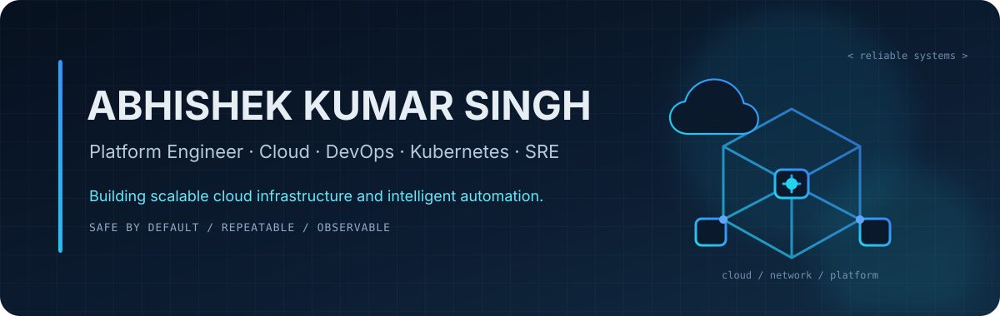

  

  
  

Portfolio focus: cloud platforms · Kubernetes · DevOps · reliability · automation

---

## About

<table>
  <tr>
    <td width="58%" valign="top">
      <h3>Platform-minded engineering</h3>
      
I’m building a practical portfolio focused on platform engineering, cloud infrastructure, DevOps, and SRE. My current documented work centers on a structured Google Cloud learning workspace and hands-on engineering labs.

      
<strong>Engineering approach:</strong> safe defaults, least privilege, repeatable steps, explicit validation, cost awareness, and cleanup instructions.

      
<strong>Current focus:</strong> developing reviewable cloud and infrastructure labs, and documenting what I learn without overstating production experience.

      
<strong>Current project:</strong> <a href="https://github.com/abhisheksingh-infracraft/gcp-training">GCP Training</a> — structured GCP modules, lab templates, setup notes, and safety guidance.

    </td>
    <td width="42%" valign="top">
      
    </td>
  </tr>
</table>

---

## Technical toolbox

Technology badges below identify areas of interest and learning, not a claim that all tools have equal proficiency or professional deployment experience. **Verified repository signal:** PowerShell currently appears in the GCP training repository.

### Operating Systems

  
  
  
  
  

### Developer Tools &amp; CLI

  
  
  
  
  
  
  
  
  
  
  
  
  

Skill Icons overview:

  

### Cloud Platforms

  
  
  

Cloud foundations · IAM · virtual networks · managed Kubernetes · cost-aware lab design.

### Kubernetes &amp; Containers

  
  
  

GKE / AKS learning · deployments · services · package management · access controls.

### Infrastructure as Code

  
  

Infrastructure automation · configuration management · repeatable, reviewable changes.

### CI/CD

  
  
  

Git workflows · CI validation · automated build and release concepts.

### GitOps

  
  

Declarative desired state · reconciliation · version-controlled delivery.

### Security

  
  
  

Least privilege · IAM fundamentals · dependency and image scanning concepts · security-minded defaults.

### Networking

  
  
  

VPC/VNet concepts · subnets · routing · DNS · ingress and egress · TLS basics.

### Observability &amp; SRE

  
  
  

Metrics · dashboards · alerting · reliability practices · actionable signals.

### API Platform Engineering

  

Apigee Hybrid and GKE are planned learning areas, not claims of professional implementation.

---

## Featured work

<table>
  <tr>
    <td width="50%" valign="top">
      <h3>Google Cloud learning workspace</h3>
      
      
Structured learning path with module outlines, lab templates, setup guidance, PowerShell Git utilities, and safety reminders.

      
<strong>Status:</strong> existing repository; private, so implementation details are not public.

      
<a href="https://github.com/abhisheksingh-infracraft/gcp-training">Repository ↗</a>

    </td>
    <td width="50%" valign="top">
      <h3>DevOps Labs (fork)</h3>
      
      
A public fork described as 64 hands-on DevOps labs. This is a forked project, not presented as original work.

      
<strong>Status:</strong> fork; inspect upstream attribution and license before reusing or claiming contributions.

      
<a href="https://github.com/abhisheksingh-infracraft/devops-labs">Fork repository ↗</a>

    </td>
  </tr>
</table>

### Planned engineering case studies

The cards below are **planned learning topics**, not deployed projects. Architecture illustrations describe example patterns only. No repository links are shown for projects that do not yet exist.

<table>
  <tr>
    <td width="50%" valign="top">
      <h3>GCP networking + GKE</h3>
      
      
<strong>Status:</strong> planned case study · VPC, subnets, routing, controlled egress, cluster, and workload.

    </td>
    <td width="50%" valign="top">
      <h3>Kubernetes engineering</h3>
      
      
<strong>Status:</strong> planned case study · workload rollout, service discovery, access controls, and troubleshooting.

    </td>
  </tr>
  <tr>
    <td width="50%" valign="top">
      <h3>CI/CD automation</h3>
      
      
<strong>Status:</strong> planned case study · validation, image publication, and a guarded deployment flow.

    </td>
    <td width="50%" valign="top">
      <h3>GitOps deployment</h3>
      
      
<strong>Status:</strong> planned case study · version-controlled desired state and reconciliation.

    </td>
  </tr>
  <tr>
    <td width="50%" valign="top">
      <h3>Observability</h3>
      
      
<strong>Status:</strong> planned case study · metrics collection, useful dashboards, and alert design.

    </td>
    <td width="50%" valign="top">
      <h3>Apigee Hybrid</h3>
      
      
<strong>Status:</strong> planned learning topic · architecture and operations study. Follow official docs for supported configurations.

    </td>
  </tr>
</table>

---

## Experience, learning &amp; achievements

My public profile does not currently document an employment timeline, verified certifications, or awards. I have not added unverified claims. The current public evidence is this portfolio and a forked DevOps Labs repository; learning areas are labeled accordingly.

---

## GitHub analytics

Live cards below are rendered by third-party services and can be unavailable or rate-limited. Each card is embedded as a standalone HTML `` element—not a text link. If a card does not load, use the [GitHub profile](https://github.com/abhisheksingh-infracraft) and its repositories.

  
  

  

  

---

## Contact

- **GitHub:** [@abhisheksingh-infracraft](https://github.com/abhisheksingh-infracraft)
- Add a professional networking or email link here when you choose to share it publicly.

---

Designed for GitHub Markdown. Local SVG diagrams are conceptual learning visuals, not deployment claims. Portfolio status: in progress.

